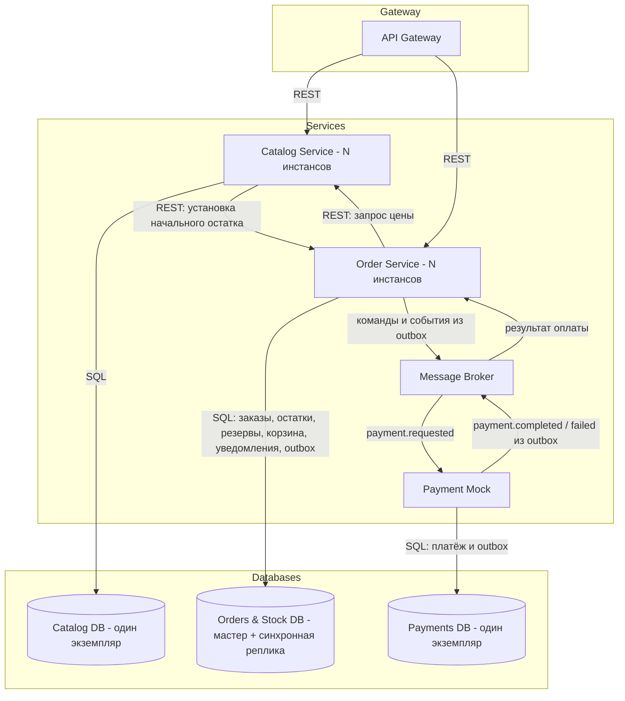
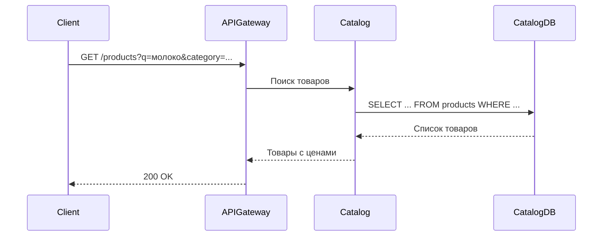
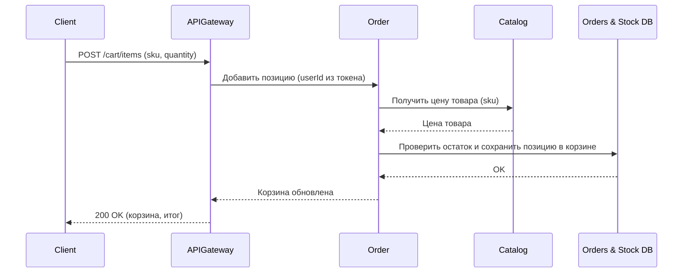
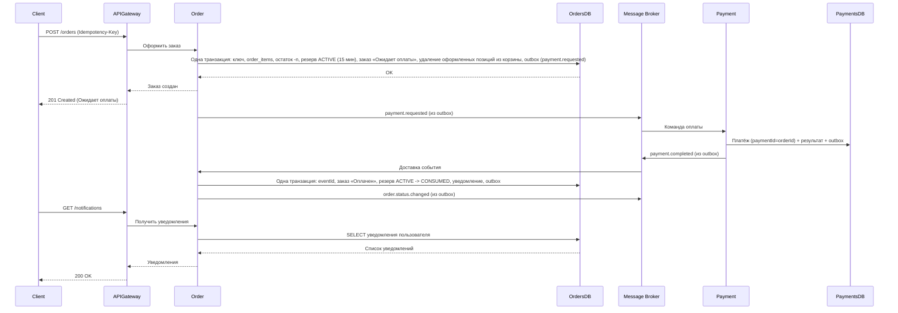
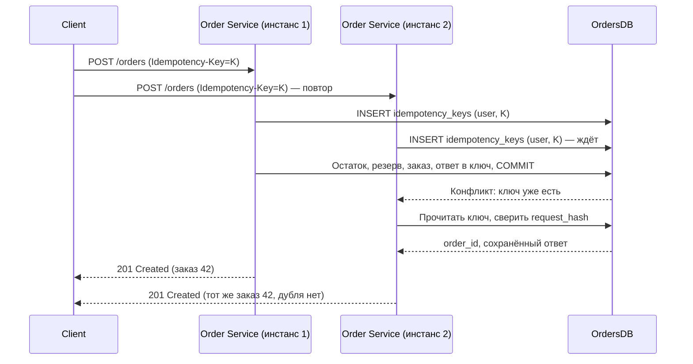
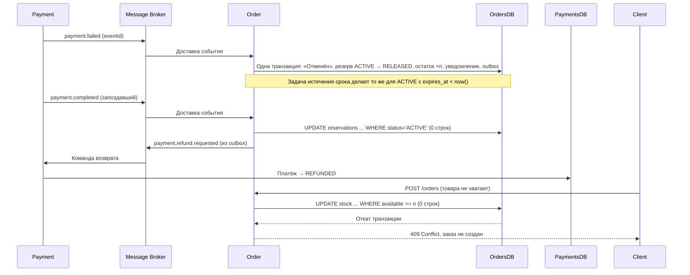
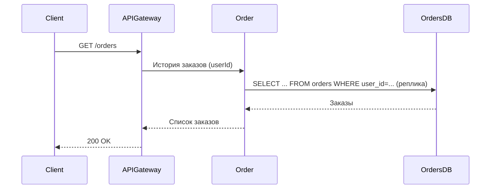
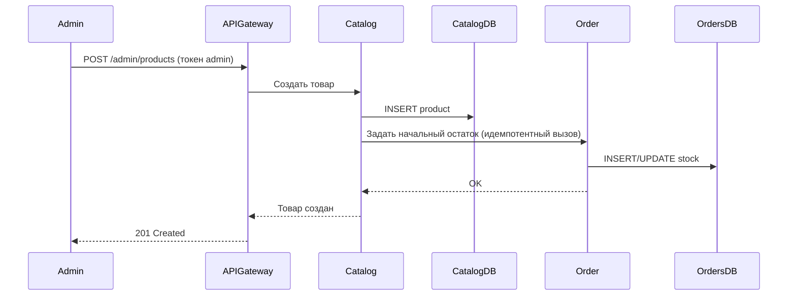
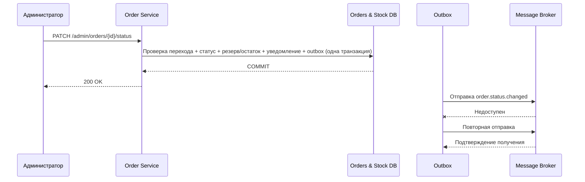
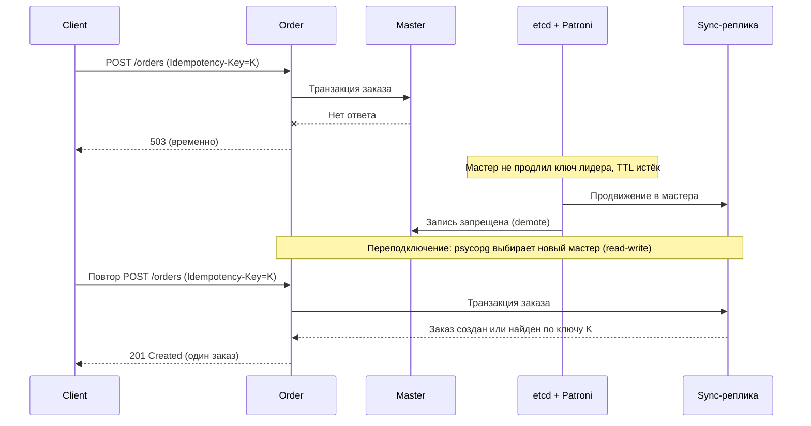

# Техническое решение проекта «Магазин Семёрочка»

## **Введение**

*   **Краткое описание:** Учебный проект, реализующий прототип системы для онлайн-заказа товаров из магазина «Семёрочка». Система позволяет просматривать каталог, управлять корзиной, оформлять заказы.
*   **Цель проекта:** Реализовать прототип масштабируемой и отказоустойчивой системы электронной коммерции, демонстрирующей ключевые принципы построения распределённых приложений.
*    **Основания для разработки:** учебный проект по курсу «Распределенные системы».
*   **Задачи:**
    *   Закрепить теоретические основы распределённых систем (масштабируемость, отказоустойчивость, консистентность) через практическую реализацию.
    *   Продемонстрировать применение концепций курса: ненадёжная доставка сообщений, частичные отказы, распределение данных и нагрузки.
      
  **Ограничения на предметную область:**
*   Система работает только с товарами, представленными в конкретной сети магазинов «Семёрочка».
*   Оплата заказа происходит только онлайн (имитация).
*   На первое время не реализована доставка и доступен только самовывоз.
*   Регистрации и входа нет: пользователи (обычные и администратор) заданы заранее, токены выдаются при развёртывании стенда.
  
*   **Состав команды:**
    *   Глинских Семён Леонидович - архитектор / DevOps
    *   Шабельников Максим Петрович - Backend-разработчик заказов и склада
    *   Яцына Полина Андреевна - Frontend-разработчик / QA
    *   Олейникова Елизавета Олеговна (тимлид) - Backend-разработчик каталога
---
## **Глоссарий**

| Термин | Определение |
|---|---|
| Товар (Product) | Единица продукции в каталоге, доступная для заказа. |
| SKU (Stock Keeping Unit) | Уникальный идентификатор товарной позиции. |
| Каталог (Catalog) | Совокупность товаров с названиями, категориями, ценами и описаниями. |
| Категория (Category) | Группа товаров, объединённых по общему признаку. |
| Корзина (Cart) | Набор товаров и их количеств, выбранных пользователем. Хранится в БД заказов. |
| Заказ (Order) | Запрос пользователя на покупку товаров с самовывозом. |
| Позиция заказа (Order Item) | Отдельный товар и его количество в составе заказа. |
| Остаток (Stock) | Количество единиц товара, доступных для продажи. |
| Резервирование (Reservation) | Временное закрепление необходимого количества товара за заказом до завершения оплаты или отмены заказа. |
| Самовывоз (Pickup) | Способ получения заказа пользователем в выбранном магазине. |
| Пользователь (User) | Клиент системы, идентифицируемый по данным JWT-токена и имеющий права на просмотр каталога, управление корзиной и оформление заказов. |
| Администратор (Admin) | Пользователь с ролью `admin`, имеющий права на управление товарами, остатками и статусами заказов. |
| Цена (Price) | Стоимость одной единицы товара. |
| Стоимость заказа (Order Total) | Итоговая стоимость всех позиций заказа. |
| Оплата (Payment) | Имитационное подтверждение оплаты заказа. |
| Статус заказа (Order Status) | Текущее состояние заказа: «Ожидает оплаты», «Оплачен», «Готов к выдаче»,  «Выдан», «Отменён». |
| История заказов (Order History) | Список заказов пользователя с информацией об их составе, стоимости и статусах. |
| JWT (JSON Web Token) | Токен, содержащий идентификатор пользователя и его роль. Используется API Gateway для проверки подписи и определения прав доступа. |
| Ключ идемпотентности (Idempotency Key) | Уникальный идентификатор запроса, позволяющий избежать повторного создания заказа при повторной отправке одного запроса. |
| Outbox | Таблица в той же базе данных, что и основные данные, в которой сохраняются события для последующей публикации в брокер сообщений. |
| Брокер сообщений (Message Broker) | Компонент, обеспечивающий передачу команд и событий между сервисами. |
| Репликация (Replication) | Процесс копирования данных с основного экземпляра базы данных на дополнительный экземпляр. |
| Отказоустойчивое переключение (Failover) | Автоматическое переключение на реплику базы данных при отказе основного экземпляра.
---

## **Функциональные требования**

Система должна предоставлять следующие функции:

*   Просмотр каталога товаров с возможностью поиска и фильтрации.
*   Добавление товаров в корзину, изменение их количества и удаление позиций.
*   Оформление заказа с самовывозом, атомарным резервированием необходимого количества товаров на 15 минут и последующей имитацией онлайн-оплаты.
*   Просмотр истории заказов пользователя.
*   Управление товарами и остатками: администратор может добавлять новые товары, указывать их названия, категории, цены и начальные остатки, а также просматривать и изменять данные о существующих товарах и их остатках.
*   Управление статусами заказов: администратор может просматривать текущий статус заказа и изменять его в соответствии с допустимыми переходами между статусами.
*   Уведомление пользователя об изменении статуса заказа с возможностью просмотра уведомлений через API.
*   Публикация событий: при изменении статуса заказа система публикует соответствующее событие. Повторная обработка команд и событий потребителями не должна приводить к повторному применению их эффектов. Для этого потребители используют дедупликацию по eventId.

---  
## **Нефункциональные требования**

- **Масштабируемость:** Возможность горизонтального масштабирования Catalog Service и Order Service за счёт запуска нескольких экземпляров. Запись в Orders & Stock DB ограничена одним основным узлом, поэтому масштабирование Order Service ограничено производительностью базы данных.

- **Отказоустойчивость:** При отказе основного узла Orders & Stock DB система должна обнаруживать его недоступность с помощью Patroni и etcd и выполнять переключение на синхронную реплику (failover). Во время переключения операции оформления заказа и работы с корзиной могут быть временно недоступны. После переключения доступность каталога и истории заказов должна сохраняться, а работа с корзиной и оформление заказов должны возобновляться без нарушения согласованности данных. Подтверждённые транзакции не должны теряться.

- **Согласованность операций:** При оформлении заказа создание заказа, резервирование необходимого количества товаров, изменение остатков и запись события в Outbox должны выполняться в рамках одной транзакции. Система не должна допускать ситуации, при которой заказ создан без соответствующего резервирования или остатки изменены без создания заказа.

- **Предотвращение продажи сверх доступного остатка:** Одна и та же единица запаса не должна резервироваться или продаваться для нескольких заказов одновременно. При параллельном оформлении заказов система должна гарантировать, что суммарное количество зарезервированных и проданных товаров не превышает исходный запас, а доступный остаток не становится отрицательным. Резерв создаётся одновременно с заказом и действует 15 минут, пока ожидается оплата. Если оплата не подтверждена в установленный срок, заказ отменяется, а резерв освобождается и товар возвращается в доступный остаток.

- **Доставка событий:** Для доставки команд и событий между сервисами используется семантика at-least-once, допускающая повторную доставку сообщений. Потребители обрабатываемых ими сообщений выполняют дедупликацию по eventId, сохраняя информацию об обработанных событиях. Изменение состояния и регистрация обработки события выполняются в одной транзакции. Событие order.status.changed сохраняется в outbox и публикуется в брокер, но в текущей версии отдельного потребителя для него нет.
---

## **Пользовательские сценарии**

### Сценарий: просмотр и поиск товаров

1. Пользователь открывает каталог товаров через клиентское приложение.
2. Система возвращает список товаров с их названиями, описаниями, ценами и изображениями.
3. Пользователь выполняет поиск по названию или применяет фильтры по категории и цене.
4. Система возвращает подходящие товары.
5. Пользователь открывает карточку товара и просматривает подробную информацию.

### Сценарий: управление корзиной

1. Пользователь добавляет товар в корзину и указывает необходимое количество.
2. Система проверяет доступность товара и сохраняет позицию в корзине.
3. Пользователь открывает корзину и просматривает её содержимое и итоговую стоимость.
4. Пользователь изменяет количество товаров или удаляет позиции.
5. Система обновляет корзину и пересчитывает итоговую стоимость.

### Сценарий: оформление заказа

1. Пользователь переходит к оформлению заказа, проверяет состав корзины и выбирает самовывоз.
2. Пользователь подтверждает заказ.
3. Система проверяет наличие товаров на складе и в одной транзакции резервирует необходимое количество, создаёт заказ со статусом «Ожидает оплаты», сохраняет состав заказа и удаляет из корзины только оформленные позиции. Резерв действует 15 минут — столько ожидается оплата. Затем система инициирует имитацию онлайн-оплаты.
4. Если оплата проходит успешно, система изменяет статус заказа на «Оплачен», переводит резерв из состояния ACTIVE в CONSUMED и сообщает пользователю об успешной оплате. После подготовки заказа администратор переводит его в статус «Готов к выдаче», а после передачи товара пользователю — в статус «Выдан». При изменении статуса пользователь получает уведомление.
5. Если оплата завершается неуспешно, система изменяет статус заказа на «Отменён», освобождает зарезервированные товары и уведомляет пользователя о неуспешной оплате.
6. Если оплата не подтверждена в течение 15 минут после создания заказа, система автоматически переводит заказ в статус «Отменён» и освобождает товары для других заказов.
7. Если необходимого количества товара недостаточно, система сообщает об этом пользователю, не создаёт заказ и не резервирует товары.
8. При повторной отправке подтверждения заказа (например, после обрыва связи) система не создаёт второй заказ и возвращает уже созданный.

### Сценарий: просмотр истории и информации о заказах

1. Пользователь открывает историю заказов.
2. Система возвращает список прошлых заказов с их составом, суммами и статусами.
3. Пользователь выбирает конкретный заказ.
4. Система возвращает подробную информацию о заказе и его текущий статус.

### Сценарий: управление товарами и остатками администратором

1. Администратор использует заранее выданный JWT-токен. API Gateway проверяет подпись токена и роль пользователя, после чего передаёт запрос соответствующему сервису.
2. Администратор добавляет новые товары, указывая их названия, категории, цены и начальные остатки, либо просматривает и изменяет данные о существующих товарах и их остатках.
3. Система сохраняет изменения и обновляет данные каталога.

### Сценарий: изменение статуса заказа администратором

1. Администратор использует заранее выданный JWT-токен. API Gateway проверяет подпись токена и роль пользователя, после чего передаёт запрос соответствующему сервису.
2. Администратор просматривает список заказов и выбирает заказ для изменения его статуса.
3. Администратор выбирает новый статус заказа из допустимых вариантов и подтверждает изменение.
4. Система проверяет допустимость перехода и сохраняет новый статус заказа.
5. Событие об изменении статуса сохраняется в outbox и публикуется в брокер с семантикой at-least-once. Повторная доставка события не приводит к повторному изменению статуса заказа.
---

## Архитектура системы

### Компоненты

1. **API Gateway** — входная точка в систему, отвечает за маршрутизацию клиентских запросов, проверку подписи JWT-токена, определение роли пользователя и валидацию запросов. Передаёт идентификатор пользователя и его роль сервисам через заголовки `X-User-Id` и `X-User-Role`.

2. **Catalog Service** — каталог товаров: поиск, фильтрация, карточки, управление товарами администратором. Stateless, масштабируется горизонтально.

3. **Order Service** — корзина, оформление заказа, резервирование и учёт остатков, статусы заказов, уведомления, Outbox и фоновые задачи. Stateless, масштабируется горизонтально. Заказы, остатки, резервы, корзины, уведомления, ключи идемпотентности и Outbox хранятся в Orders & Stock DB. Создание заказа и резервирование товара выполняются в одной локальной транзакции.

4. **Payment Mock** — имитация онлайн-оплаты; получает команду на оплату через брокер сообщений, сохраняет платёж и результат обработки в собственной БД и Outbox.

5. **Message Broker** — брокер сообщений, обеспечивающий асинхронную передачу команд и событий между сервисами. Публикация выполняется через transactional outbox с семантикой at-least-once.

6. **Базы данных (PostgreSQL):**
   - **Catalog DB** — товары. Один экземпляр без репликации.
   - **Orders & Stock DB** — заказы, остатки, резервы, корзины, уведомления, ключи идемпотентности, Outbox и обработанные события. Мастер и синхронная реплика под управлением Patroni и etcd.
   - **Payments DB** — платежи, Outbox и обработанные события. Один экземпляр без репликации.

Внешние обращения клиента идут через API Gateway по REST/HTTP. Внутренние синхронные вызовы между сервисами выполняются по REST с таймаутами и повтором при необходимости. Асинхронное взаимодействие осуществляется через Message Broker.

### Схема архитектуры

**Особенности архитектуры:**
- Catalog Service и Order Service могут масштабироваться горизонтально за счёт нескольких экземпляров.
- Order Service является владельцем Orders & Stock DB и самостоятельно управляет корзиной, резервами, остатками и уведомлениями.
- Payment Mock использует отдельную Payments DB.
- Для обеспечения отказоустойчивости репликация и автоматическое переключение (failover) реализованы только для Orders & Stock DB.
- Синхронное взаимодействие между сервисами осуществляется по REST, асинхронное — через Message Broker.
- API Gateway проверяет JWT и передаёт информацию о пользователе и его роли сервисам. Отдельный User Service не реализуется.

### Согласованное оформление заказа и защита от продажи сверх остатка

- **Проблема:** параллельные заказы могут одновременно забрать последние единицы товара; сбой между созданием заказа и изменением остатков оставляет данные несогласованными.
- **Решение:** остатки, резервы и заказы хранятся в одной БД. Резервирование выполняется атомарным условным обновлением `UPDATE stock SET available = available - :n WHERE sku = :sku AND available >= :n`; если затронуто 0 строк, товара недостаточно. Заказ, позиции заказа (order_items), резервы (таблица reservations, поле expires_at = момент создания + 15 минут), ключ идемпотентности и событие в outbox создаются одной транзакцией. В рамках этой же транзакции из корзины удаляются только позиции, включённые в оформляемый заказ. Состав заказа фиксируется на момент оформления, поэтому товары, добавленные пользователем после создания заказа, сохраняются в корзине. Резерв существует только вместе с заказом: отдельного этапа «резерв без заказа» нет, 15 минут — срок ожидания оплаты.
- **Гарантия:** остаток не становится отрицательным; одна единица не закрепляется за двумя заказами; заказ не создаётся без товара, и товар не закрепляется за несуществующим заказом.
- **Компромиссы:** единая БД для заказов и остатков упрощает согласованность, но ограничивает независимое масштабирование склада; конкурирующие запросы на одну позицию сериализуются блокировкой строки.

### Репликация и failover PostgreSQL

- **Проблема:** мастер Orders & Stock DB может отказать, а старый мастер не должен продолжать принимать записи после переключения (split-brain).
- **Решение:** для Orders & Stock DB используется Patroni с хранилищем etcd (3 узла) и синхронной репликой.
  - **Кто принимает решение.** Patroni управляет выбором мастера. Мастер продлевает ключ лидера в etcd с TTL 30 секунд. При потере лидера реплика может быть повышена до мастера.
  - **Как исключается запись в старый мастер.** После потери лидерства старый мастер переводится в режим read-only. Это предотвращает одновременную запись на двух узлах.
  - **Как сервисы находят новый мастер.** Для подключения используется строка подключения с несколькими адресами PostgreSQL и параметром `target_session_attrs=read-write`. Для чтения с реплики используется `target_session_attrs=prefer-standby`.
  - **Режим репликации.** Для Orders & Stock DB включена синхронная репликация (`synchronous_mode: true`, `synchronous_commit=on`).
- **Гарантия:** при отказе мастера Patroni выполняет переключение на реплику. Запрос, прерванный во время переключения, может завершиться ошибкой 503. Повтор запроса выполняется с тем же ключом идемпотентности.
- **Компромиссы:** синхронная репликация увеличивает задержку записи. При недоступности синхронной реплики оформление заказа может быть временно недоступно. Чтение с реплики может возвращать слегка устаревшие данные из-за задержки репликации.

### Идемпотентность оформления заказа

- **Проблема:** клиент повторяет `POST /orders` после таймаута или failover, а два запроса с одним ключом могут одновременно попасть в разные инстансы Order Service; заголовок `Idempotency-Key` сам по себе дубль не предотвращает.
- **Решение:** в Orders & Stock DB есть таблица `idempotency_keys` с первичным ключом `(user_id, key)` и полями `request_hash` (хеш тела запроса), `order_id`, `response_status`, `response_body`, `created_at`. Первым шагом транзакции оформления выполняется `INSERT INTO idempotency_keys ... ON CONFLICT DO NOTHING`; затем в той же транзакции создаются заказ, резерв и outbox, и в строку записывается `order_id` и ответ. Запись ключа фиксируется вместе с заказом и резервом: существует либо всё, либо ничего.
- **Что получает повторный запрос:**
  - ключ найден, `request_hash` совпадает — сохранённый ответ первого запроса (тот же заказ, статус 201), новый заказ и резерв не создаются;
  - ключ найден, `request_hash` отличается — ошибка 422 (ключ использован с другим запросом);
  - первая транзакция откатилась (например, не хватило товара или БД отказала) — ключ не сохранился, повтор выполняется как новый запрос.
- **Одновременные запросы с одним ключом в разные инстансы:** уникальный индекс гарантирует, что вставку выполнит одна транзакция; вторая блокируется на вставке до фиксации или отката первой. После фиксации она видит существующий ключ и возвращает сохранённый ответ; после отката — выполняет оформление сама.
- **Срок хранения:** ключи хранятся 24 часа и удаляются фоновой задачей.
- **Гарантия:** при любом количестве повторов и failover с одним ключом создаётся не более одного заказа и одного резерва.
- **Компромиссы:** дополнительная запись на каждый заказ; блокировка второго запроса на время первой транзакции.

### Протокол оплаты и восстановление незавершённой оплаты

- **Проблема:** (1) Order Service может завершиться после фиксации заказа, но до запуска оплаты; (2) брокер может быть недоступен при публикации результата; (3) таймаут вызова не означает, что оплата не выполнена.
- **Решение:** оплата запускается не прямым вызовом, а командой через брокер.
  1. В транзакции оформления заказа в outbox записывается команда `payment.requested` с `paymentId = orderId`, суммой и `eventId`. Если Order Service упадёт после фиксации, команда остаётся в outbox и будет отправлена relay-процессом любого инстанса.
  2. Payment Mock получает команду и в одной транзакции своей БД (Payments DB) создаёт запись платежа `payments(payment_id PK, order_id, amount, status)` с `INSERT ... ON CONFLICT DO NOTHING` и записывает результат (`COMPLETED` или `FAILED`) вместе с событием в собственную outbox-таблицу. Результат имитации определяется детерминированно по `paymentId` и сумме (правило настраивается для тестов), поэтому повторная команда с тем же `paymentId` даёт тот же результат и не создаёт второй платёж.
  3. Relay Payment Mock публикует `payment.completed` или `payment.failed` в брокер с повторами до подтверждения. Если брокер недоступен, результат остаётся в outbox Payments DB, повторы выполняет Payment Mock.
  4. Order Service получает результат и применяет его по правилам переходов (см. ниже).
- **Восстановление:** состояние незавершённой оплаты определяется двумя таблицами — outbox Order Service (команда отправлена или нет) и `payments` (результат получен или нет). Любой сбой лечится повтором соответствующей отправки; связь повторного запуска с оплатой обеспечивает `paymentId = orderId`. Если за 15 минут результата нет, заказ отменяется задачей истечения срока (см. ниже); запоздавший `payment.completed` для отменённого заказа не применяется, Order Service публикует `payment.refund.requested`, Payment Mock переводит платёж в `REFUNDED`.
- **Гарантия:** команды и результаты оплаты сохраняются в outbox и повторно публикуются при временной недоступности брокера. Повторная обработка команды с тем же paymentId не создаёт второй платёж. Повторная обработка команд и результатов оплаты не применяет один и тот же эффект несколько раз благодаря идемпотентности и дедупликации по eventId.
- **Компромиссы:** оплата стартует с задержкой на интервал опроса outbox (порядка секунды); добавляется отдельная БД Payments DB.

### Состояния резерва и заказа, взаимоисключающие переходы

Состояния резерва: `ACTIVE` (товар удержан для неоплаченного заказа), `CONSUMED` (товар продан), `RELEASED` (товар возвращён в доступный остаток). Состояния заказа: «Ожидает оплаты», «Оплачен», «Готов к выдаче», «Выдан», «Отменён».

Допустимые переходы (любой другой отклоняется):

| Переход заказа | Кто инициирует | Резерв | Остаток `stock.available` |
|---|---|---|---|
| (нет) → «Ожидает оплаты» | `POST /orders` | создаётся `ACTIVE` | уменьшается на количество |
| «Ожидает оплаты» → «Оплачен» | событие `payment.completed` | `ACTIVE` → `CONSUMED` | без изменений |
| «Ожидает оплаты» → «Отменён» | событие `payment.failed` | `ACTIVE` → `RELEASED` | увеличивается на количество |
| «Ожидает оплаты» → «Отменён» | задача истечения срока (`expires_at`) | `ACTIVE` → `RELEASED` | увеличивается на количество |
| «Ожидает оплаты» → «Отменён» | администратор | `ACTIVE` → `RELEASED` | увеличивается на количество |
| «Оплачен» → «Готов к выдаче» | администратор | без изменений | без изменений |
| «Готов к выдаче» → «Выдан» | администратор | без изменений | без изменений |

«Выдан» и «Отменён» — конечные состояния. Администратор не может вручную перевести заказ в «Оплачен».

Взаимоисключение обеспечивается условным обновлением (compare-and-set) в одной транзакции с изменением остатка:

- Оплата: `UPDATE reservations SET status='CONSUMED' WHERE order_id=:id AND status='ACTIVE'` и `UPDATE orders SET status='PAID' WHERE id=:id AND status='PENDING_PAYMENT'`.
- Освобождение (событие, задача истечения срока, администратор): `UPDATE reservations SET status='RELEASED' WHERE ... AND status IN (разрешённые для перехода) RETURNING ...`; остаток увеличивается только на количество строк, реально переведённых в `RELEASED`. Задача истечения срока дополнительно требует `status='ACTIVE' AND expires_at < now()`.
- Если условное обновление затронуло 0 строк, переход уже выполнен другим обработчиком: событие игнорируется. Оплаченный (`CONSUMED`) резерв поэтому не может быть возвращён задачей истечения срока, а освобождённый (`RELEASED`) — стать проданным при запоздалом `payment.completed` (в этом случае публикуется `payment.refund.requested`).

Дедупликация по eventId применяется при обработке событий потребителями. Согласованность между разными событиями (оплата, истечение срока, действия администратора) обеспечивается условными переходами и проверкой текущего состояния заказа и резерва.

### Доставка событий и идемпотентность потребителей

- **Проблема:** брокер может терять сообщения и доставлять их повторно.
- **Решение:** события и команды записываются в outbox-таблицу в той же транзакции, что и изменение состояния (в Order Service — вместе с заказом и статусом, в Payment Mock — вместе с результатом платежа), и пересылаются в брокер с повторами до подтверждения (at-least-once). Потребители (Order Service, Payment Mock) хранят идентификаторы обработанных сообщений (`eventId`) в таблице `processed_events`; запись о событии и применение эффекта выполняются в одной транзакции своей БД.
- **Гарантия:** событие не теряется при временной недоступности брокера; повторная доставка не приводит к повторному применению эффекта.
- **Компромиссы:** выбрана семантика at-least-once вместо at-most-once: потеря события хуже дубликата, а дубли устраняются дедупликацией; уведомления и результаты могут приходить с задержкой.

### Уведомления

- **Что такое уведомление:** запись в таблице `notifications` (`id`, `user_id`, `order_id`, `text`, `created_at`, `read`) в Orders & Stock DB. Пользователь получает уведомления запросом `GET /notifications`; отправка по e-mail, SMS или push в прототипе не реализуется.
- **Решение:** при изменении статуса заказа Order Service в одной транзакции обновляет статус заказа, создаёт запись в `notifications` и записывает событие `order.status.changed` в outbox.
- **Гарантия:** изменение статуса заказа, создание уведомления и запись события order.status.changed в outbox выполняются в одной транзакции. Повторная публикация события в брокер не приводит к повторному созданию уведомления, поскольку уведомление создаётся при изменении статуса, а не при обработке опубликованного события.
- **Компромиссы:** пользователь узнаёт об изменении при следующем запросе (polling), без немедленной отправки.

### Масштабирование и нагрузка на БД

**Реализуется:**
- индексы для фильтрации по категории и цене, поиска по названию (`pg_trgm`), фоновых задач (`status`, `expires_at`) и очистки ключей идемпотентности (`created_at`);
- чтение истории заказов и уведомлений с реплики Orders & Stock DB;
- PgBouncer перед Orders & Stock DB для ограничения числа соединений.

**Кэш каталога не реализуется.** Остатки хранятся в Orders & Stock DB и проверяются непосредственно в БД при добавлении товара в корзину и оформлении заказа. Catalog масштабируется горизонтально за счёт нескольких stateless-инстансов и индексов.

**Известное ограничение:** запись в Orders & Stock DB выполняется через один мастер. Конкурирующие заказы на одну позицию сериализуются блокировкой строки, поэтому масштабирование Order Service ограничено пропускной способностью БД. Catalog масштабируется практически линейно.

**Возможное развитие (не реализуется):** кэширование карточек каталога с коротким TTL, шардирование заказов по `user_id`, выделение склада в отдельный сервис с собственной БД и использованием саги вместо общей транзакции «заказ + резерв».

### Обработка частичных отказов

- **Проблема:** сервис или узел может отказать «молча»; таймаут вызова не доказывает, что операция не выполнена.
- **Решение:**
  - отказ мастера БД определяют Patroni и etcd, а не сервисы приложения; при ошибке подключения сервис возвращает 503, клиент повторяет запрос с тем же `Idempotency-Key`;
  - оплата не вызывается синхронно: команда доставляется через outbox и брокер и безопасна к повторам по `paymentId`. Если результат не получен за 15 минут, заказ отменяется, а запоздавшая успешная оплата возвращается (`REFUNDED`);
  - синхронные REST-вызовы между сервисами выполняются с таймаутом и одним повтором. Например, если Order Service не может получить цену из Catalog, операция добавления товара в корзину завершается ошибкой; при недоступности Catalog просмотр уже загруженного каталога не затрагивается;
  - отказ одного инстанса stateless-сервиса компенсируется остальными инстансами за балансировщиком.
- **Гарантия:** отказ одного инстанса stateless-сервиса не приводит к остановке всей системы. Подтверждённые изменения Orders & Stock DB сохраняются при переключении на синхронную реплику. Незавершённые запросы могут потребовать повтора с тем же ключом идемпотентности.
- **Компромиссы:** короткий таймаут порождает ложные срабатывания, длинный замедляет реакцию; повторы требуют идемпотентности операций.
---

## Технические сценарии

### Сценарий: просмотр и поиск товаров

1. Клиент отправляет в API Gateway запрос GET /products с параметрами `q`, `category`, `minPrice`, `maxPrice`, `limit`, `offset`.
2. API Gateway перенаправляет запрос в один из инстансов Catalog Service.
3. Catalog Service читает товары из Catalog DB.
4. Клиент получает список товаров; карточка открывается запросом GET /products/{sku}. Остатки в каталоге не отображаются.

### Сценарий: управление корзиной

1. Клиент отправляет POST /cart/items (sku, quantity), PATCH /cart/items/{sku} для изменения количества или DELETE /cart/items/{sku} для удаления позиции.
2. API Gateway проверяет токен и передаёт запрос в Order Service.
3. Order Service получает цену товара из Catalog, проверяет доступность в Orders & Stock DB и сохраняет изменение в корзине.
4. Клиент запрашивает GET /cart; Order Service возвращает позиции и итоговую стоимость.

### Сценарий: оформление заказа (успешная оплата)

1. Клиент отправляет POST /orders с заголовком `Idempotency-Key`; запрос означает подтверждение заказа с самовывозом.
2. Order Service в одной транзакции: фиксирует ключ идемпотентности, сохраняет состав корзины в order_items, атомарно уменьшает остатки по позициям заказа, создаёт резервы (ACTIVE, expires_at = +15 минут), создаёт заказ со статусом «Ожидает оплаты», удаляет из корзины только оформленные позиции и записывает в outbox команду payment.requested (paymentId = orderId) и событие о создании заказа.
3. Order Service возвращает клиенту заказ (201).
4. Relay публикует команду в брокер; Payment Mock создаёт платёж, определяет результат и записывает `payment.completed` в свою outbox-таблицу; relay Payment Mock публикует событие.
5. Order Service получает событие, проверяет eventId в processed_events и в одной транзакции переводит заказ в «Оплачен», резерв — в CONSUMED, создаёт уведомление и записывает событие в outbox. Очистка корзины на этом этапе не выполняется, поскольку оформленные позиции были удалены при создании заказа.
6. Клиент получает уведомление запросом `GET /notifications`.

### Сценарий: повторный запрос оформления заказа

1. Клиент не получил ответ на `POST /orders` (таймаут или failover) и повторяет запрос с тем же `Idempotency-Key`, иногда практически одновременно с исходным запросом; повтор попадает в другой инстанс Order Service.
2. Оба инстанса начинают транзакцию с вставки `(user_id, key)` в `idempotency_keys`; вставку выполняет одна транзакция, вторая ожидает её завершения.
3. Если первая транзакция зафиксирована, вторая находит ключ, сверяет `request_hash` и возвращает сохранённый ответ (тот же заказ), не создавая нового заказа и резерва. Если `request_hash` отличается, возвращается 422.
4. Если первая транзакция откатилась, вторая выполняет оформление заказа сама.

### Сценарий: неуспешная оплата, истечение срока оплаты и нехватка товара

1. Неуспешная оплата: Payment Mock публикует `payment.failed`; Order Service в одной транзакции переводит заказ из «Ожидает оплаты» в «Отменён», резерв `ACTIVE` → `RELEASED`, возвращает остаток, создаёт уведомление и пишет событие в outbox.
2. Истечение срока: фоновая задача Order Service находит резервы `ACTIVE` с `expires_at < now()` и в транзакции переводит их в `RELEASED`, возвращает остаток, отменяет заказ и создаёт уведомление. Если заказ уже оплачен (резерв `CONSUMED`), условие не выполняется и задача его не затрагивает.
3. Запоздавшая оплата: `payment.completed` приходит после отмены; условное обновление `status='ACTIVE'` затрагивает 0 строк, заказ остаётся «Отменён», Order Service пишет в outbox `payment.refund.requested`, Payment Mock получает команду и переводит платёж в `REFUNDED`.
4. Нехватка товара: условное обновление остатка затрагивает 0 строк, транзакция откатывается (ключ идемпотентности не сохраняется), заказ не создаётся, клиент получает 409 Conflict.

### Сценарий: просмотр истории и информации о заказах

1. Клиент отправляет GET /orders, затем GET /orders/{orderId}.
2. API Gateway перенаправляет запрос в Order Service.
3. Order Service читает заказы пользователя из реплики Orders & Stock DB и возвращает состав, суммы и статусы.

### Сценарий: управление товарами и остатками администратором

1. Администратор использует заранее выданный токен; API Gateway проверяет роль.
2. Администратор отправляет POST /admin/products (название, категория, цена, начальный остаток) либо PUT /admin/products/{sku}, PUT /admin/stock/{sku}.
3. Catalog Service сохраняет данные товара в Catalog DB и вызывает Order Service для установки начального остатка. Вызов идемпотентен: повторный запрос с теми же данными не должен приводить к повторному изменению остатка. При ошибке вызов повторяется до успешного выполнения.

### Сценарий: изменение статуса заказа администратором и повторная доставка события

1. Администратор отправляет PATCH /admin/orders/{orderId}/status с новым статусом.
2. Order Service проверяет допустимость перехода по таблице переходов и в одной транзакции сохраняет статус, меняет резерв и остаток согласно таблице, создаёт уведомление и пишет событие в outbox. Недопустимый переход отклоняется (409).
3. Отправитель outbox публикует событие в брокер; если брокер недоступен, отправка повторяется до подтверждения (at-least-once).
4. Брокер подтверждает получение события. Публикация выполняется с семантикой at-least-once, поэтому событие может быть доставлено повторно будущим потребителям.

### Сценарий: отказ мастера БД

1. Во время оформления заказа мастер Orders & Stock DB перестаёт отвечать; соединение Order Service разрывается, клиент получает 503.
2. Мастер не продлевает ключ лидера в etcd; по истечении TTL Patroni продвигает синхронную реплику (в ней есть все подтверждённые транзакции) и исключает запись в старый мастер: потерявший ключ узел переводится в режим чтения.
3. Сервисы переподключаются по мультихост-строке подключения PostgreSQL с `target_session_attrs=read-write`; драйвер `psycopg` находит новый мастер.
4. Каталог и просмотр истории заказов (с реплики) продолжают работать; операции с Orders & Stock DB, включая оформление заказа и работу с корзиной, могут быть временно недоступны до завершения переключения.
5. Клиент повторяет `POST /orders` с тем же `Idempotency-Key`: если исходная транзакция была зафиксирована, возвращается тот же заказ, иначе заказ создаётся один раз.

---

## План разработки и тестирования

**Включает:**
- Каталог с поиском и фильтрацией, управление товарами и остатками администратором
- Корзина, оформление заказа с резервированием на 15 минут на время ожидания оплаты, имитация оплаты
- История заказов, управление статусами заказов
- Message Broker, transactional outbox, идемпотентная обработка событий, идемпотентность оформления заказа
- Репликация PostgreSQL с failover на Patroni, горизонтальное масштабирование Catalog и Order Service

**План разработки:**
1. Проектирование API и схем БД (товары, заказы, остатки, резервы, `idempotency_keys`, платежи, уведомления, outbox, `processed_events`)
2. Реализация API Gateway: проверка подписи JWT и ролей, передача `X-User-Id` и `X-User-Role`; выпуск заранее заданных тестовых токенов при развёртывании
3. Реализация Catalog Service (поиск, фильтры, управление товарами)
4. Реализация Order Service: корзина, атомарное резервирование, ключи идемпотентности, создание заказа, таблица переходов статусов
5. Реализация фоновых задач: освобождение просроченных резервов, очистка ключей идемпотентности
6. Реализация Payment Mock (Payments DB, детерминированный результат, outbox, возврат платежа)
7. Интеграция с Message Broker, outbox и relay, дедупликация потребителей по `eventId`
8. Реализация уведомлений в Order Service (`notifications`, `GET /notifications`)
9. Развёртывание PostgreSQL под управлением Patroni + etcd: синхронная репликация для Orders & Stock DB, настройка PgBouncer для управления пулом соединений от нескольких инстансов Order Service
10. Контейнеризация (docker-compose), запуск нескольких инстансов Catalog и Order Service за балансировщиком
11. Документирование API

**План тестирования:**
- Модульные тесты: допустимые и недопустимые переходы статусов и резервов, расчёт стоимости
- Интеграционные тесты сервисов с БД и брокером
- Тесты API Gateway (валидные/невалидные запросы, проверка подписи и срока действия JWT, проверка ролей: 401/403)
- Тест параллельного оформления: N одновременных заказов на последние единицы товара — остаток не уходит в минус, лишние заказы получают 409
- Тест атомарности: сбой в середине транзакции не оставляет заказ без резерва и резерв без заказа
- Тест идемпотентности: два одновременных `POST /orders` с одним ключом в разные инстансы создают один заказ и один резерв; тот же ключ с другим телом возвращает 422
- Тест гонки оплаты и истечения срока: оплаченный резерв не возвращается в остаток задачей истечения срока; запоздавший `payment.completed` для отменённого заказа не делает его оплаченным и порождает возврат
- Тест сбоя между фиксацией заказа и запуском оплаты: после перезапуска Order Service команда оплаты доставляется, оплата выполняется один раз
- Тест недоступности брокера при публикации результата оплаты: результат сохраняется в outbox Payment Mock и доставляется после восстановления
- Тест дедупликации событий: повторная доставка payment.completed и payment.failed не приводит к повторному изменению состояния заказа и созданию повторных уведомлений.
- Тест сохранения новых товаров в корзине: после оформления заказа пользователь добавляет новые товары в корзину до получения payment.completed. После обработки события проверяется, что новые товары остались в корзине, а состав ранее оформленного заказа не изменился.
- Тест failover: остановка мастера Orders & Stock DB — каталог и просмотр заказов доступны, корзина и оформление могут быть временно недоступны; подтверждённые заказы сохранены, оформление восстанавливается после переключения, повтор с тем же ключом не создаёт дубль
- Тест fencing: вернувшийся старый мастер не принимает записи
- Тест масштабирования: работа при нескольких инстансах Catalog и Order Service
- Нагрузочное тестирование
- Проверка граничных случаев (пустая корзина, несуществующий товар, нулевое количество)

**Definition of Done (DoD):**
- Пользователь находит товары поиском и фильтрами по категории и цене и открывает карточку товара.
- Пользователь добавляет товар в корзину, изменяет количество и удаляет позицию; корзина показывает актуальную итоговую стоимость.
- Пользователь оформляет заказ, оплата проходит в имитационном режиме, статус заказа становится «Оплачен», в уведомлениях появляется сообщение об этом.
- После оформления заказа пользователь может добавлять новые товары в корзину во время ожидания оплаты. Обработка `payment.completed` не удаляет эти товары.
- Пользователь видит список своих заказов и открывает детали заказа с составом, суммой и текущим статусом.
- Администратор добавляет товар с начальным остатком и изменяет цену и остаток существующего товара; изменения видны в каталоге.
- Администратор переводит заказ по допустимым статусам («Ожидает оплаты» → «Отменён», «Оплачен» → «Готов к выдаче» → «Выдан»); при отмене ожидающего оплаты заказа резерв освобождается, товар возвращается в доступный остаток. Пользователь видит новый статус, недопустимый переход отклоняется. Оплаченный заказ отменить нельзя.
- При неуспешной оплате и при неоплате в течение 15 минут заказ отменяется, товар возвращается в остаток.
- При параллельном оформлении остаток не уходит в минус.
- Повторный запрос оформления с тем же ключом, в том числе одновременный, не создаёт второй заказ.
- Повторная обработка payment.completed и payment.failed не приводит к повторному изменению состояния заказа и созданию второго уведомления.
- Запоздавшая оплата отменённого заказа не делает его оплаченным.
- Оформление заказа возобновляется после отказа мастера БД (failover), подтверждённые ранее заказы сохраняются.
- Запущено несколько инстансов Catalog и Order Service, система работает корректно.
