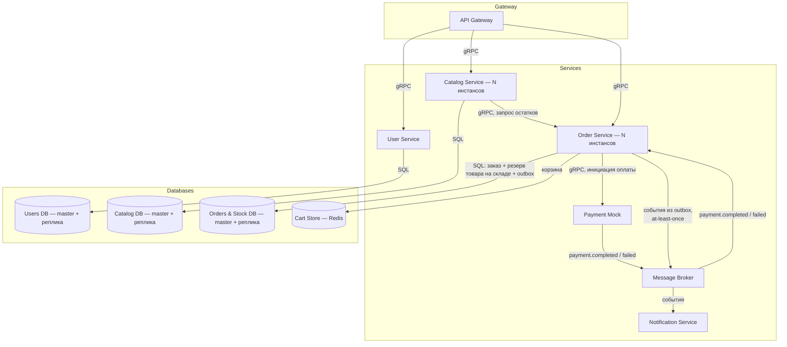
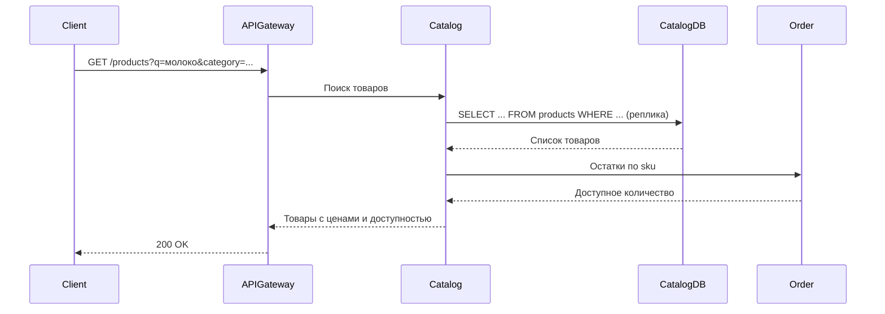
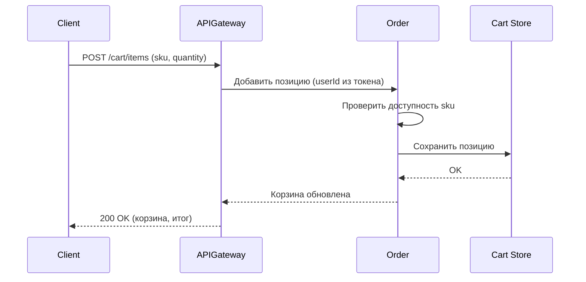
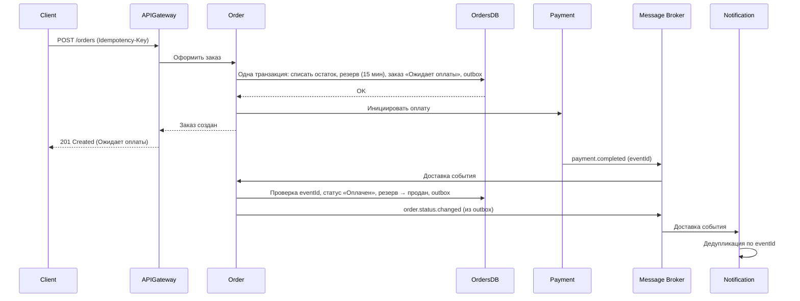
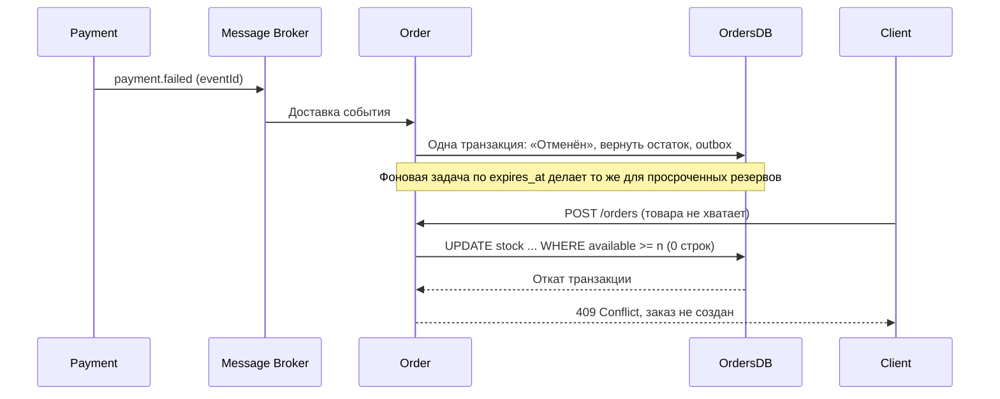
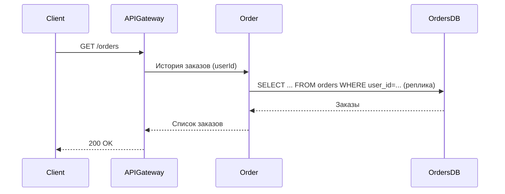
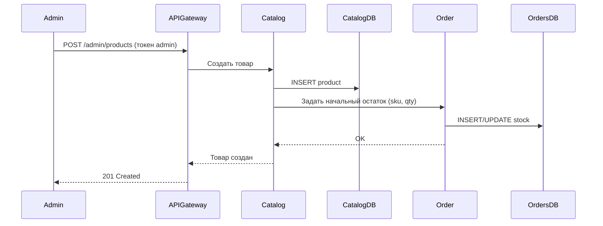
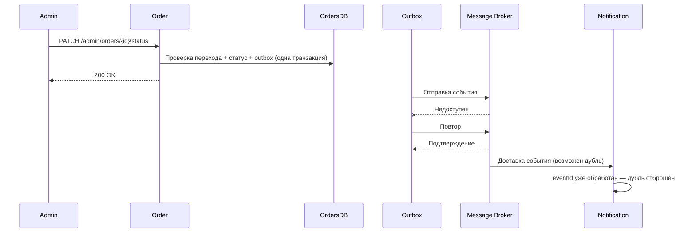
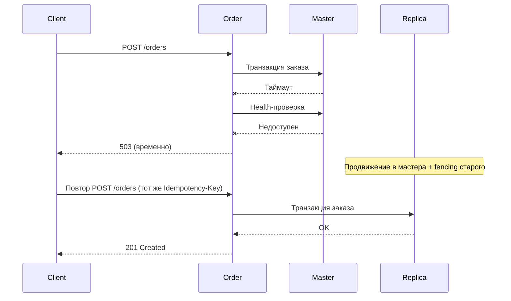

# Техническое решение проекта «Магазин Семёрочка»

## **Введение**

*   **Краткое описание:** Учебный проект, реализующий прототип системы для онлайн-заказа товаров из магазина «Семёрочка». Система позволяет просматривать каталог, управлять корзиной, оформлять заказы.
*   **Цель проекта:** Реализовать прототип масштабируемой и отказоустойчивой системы электронной коммерции, демонстрирующей ключевые принципы построения распределённых приложений.
*    **Основания для разработки:** учебный проект по курсу «Распределенные системы».
*   **Задачи:**
    *   Закрепить теоретические основы распределённых систем (масштабируемость, отказоустойчивость, консистентность) через практическую реализацию.
    *   Продемонстрировать применение концепций курса: ненадёжная доставка сообщений, частичные отказы, распределение данных и нагрузки.
      
  **Ограничения на предметную область:**
*   Система работает только с товарами, представленными в конкретной сети магазинов «Семёрочка».
*   Оплата заказа происходит только онлайн (имитация).
*   На первое время не реализована доставка и доступен только самовывоз.
  
*   **Состав команды:**
    *   Глинских Семён Леонидович - архитектор / DevOps
    *   Шабельников Максим Петрович - Backend-разработчик заказов и склада
    *   Яцына Полина Андреевна - Frontend-разработчик / QA
    *   Олейникова Елизавета Олеговна (тимлид) - Backend-разработчик каталога и пользователей
---
## **Глоссарий**

| Термин | Определение |
|---|---|
| Товар (Product) | Единица продукции, представленная в каталоге магазина и доступная для заказа. |
| SKU (Stock Keeping Unit) | Уникальный идентификатор товарной позиции, используемый для учёта товаров. |
| Каталог (Catalog) | Совокупность товаров с их названиями, категориями, ценами, описаниями и информацией о доступности. |
| Категория (Category) | Группа товаров, объединённых по общему признаку. |
| Корзина (Cart) | Набор товаров и их количеств, выбранных пользователем для оформления заказа. |
| Заказ (Order) | Запрос пользователя на покупку товаров с выбранным способом получения и определённой стоимостью. |
| Позиция заказа (Order Item) | Отдельный товар и его количество в составе заказа. |
| Остаток (Stock / Inventory Level) | Количество единиц товара, доступных для продажи. |
| Резервирование (Reservation) | Временное закрепление необходимого количества товара за заказом до завершения оплаты или отмены заказа. |
| Самовывоз (Pickup) | Способ получения заказа пользователем в выбранном магазине. |
| Пользователь (User) | Клиент системы, который просматривает каталог, формирует корзину и оформляет заказы. |
| Администратор (Admin) | Пользователь с правами управления товарами и их остатками. |
| Цена (Price) | Стоимость одной единицы товара. |
| Стоимость заказа (Order Total) | Итоговая стоимость всех позиций заказа. |
| Оплата (Payment) | Процесс подтверждения оплаты заказа; в прототипе реализуется в имитационном режиме. |
| Статус заказа (Order Status) | Текущее состояние заказа, например создан, ожидает оплаты, оплачен или отменён. |
| История заказов (Order History) | Список заказов пользователя с информацией об их составе, стоимости и статусах. |
---

## **Функциональные требования**

Система должна предоставлять следующие функции:

*   Просмотр каталога товаров с возможностью поиска и фильтрации.
*   Добавление товаров в корзину и изменение их количества.
*   Оформление заказа.
*   Просмотр истории заказов пользователя.
* Управление товарами и остатками: администратор может добавлять новые товары, указывать их названия, категории, цены и начальные остатки, а также просматривать и изменять данные о существующих товарах и их остатках.
*   Управление статусами заказов: администратор может просматривать текущий статус заказа и изменять его в соответствии с допустимыми переходами между статусами.
*   Публикация событий: при изменении статуса заказа система публикует соответствующее событие. Повторная доставка одного и того же события не должна приводить к повторному применению его эффекта.

---  
## **Нефункциональные требования**

- **Масштабируемость:** Возможность горизонтального масштабирования сервисов каталога и заказов.
- **Отказоустойчивость:** При отказе основного узла базы данных система должна обнаруживать его недоступность по тайм-ауту и выполнять переключение на реплику (failover). После переключения должны сохраняться просмотр каталога, работа с корзиной и просмотр заказов. На время переключения операции оформления заказа могут быть временно недоступны. После восстановления работы базы данных система должна возобновить их выполнение без нарушения согласованности данных.
- **Согласованность операций:** При оформлении заказа создание заказа и соответствующее изменение остатков должны выполняться согласованно. Система не должна допускать ситуации, при которой заказ создан, но соответствующее изменение остатков не выполнено, или остатки изменены, но заказ не создан.
- **Предотвращение продажи сверх доступного остатка:** Одна и та же единица запаса не должна резервироваться или продаваться для нескольких заказов одновременно. При параллельном оформлении заказов система должна гарантировать, что количество зарезервированного и проданного товара не превышает доступный запас, а доступный остаток не становится отрицательным. Временный резерв допускается до создания заказа. Гарантия согласованности относится к созданию заказа и закреплению зарезервированного количества за ним: товар не должен закрепляться за несуществующим заказом, а заказ не должен создаваться без необходимого количества товара. Если пользователь не подтверждает заказ в установленный срок, резерв освобождается.
- **Доставка событий:** Для событий об изменении статуса заказа используется семантика at-least-once, допускающая повторную доставку сообщения. Повторная доставка одного и того же события не должна приводить к повторному применению его эффекта: система может повторно получить и проверить событие, но состояние заказа не должно изменяться повторно из-за одного и того же события (идемпотентность).
---

## **Пользовательские сценарии**

### Сценарий: просмотр и поиск товаров

1. Пользователь открывает каталог товаров через клиентское приложение.
2. Система возвращает список доступных товаров с названиями, категориями, ценами и доступностью.
3. Пользователь выполняет поиск по названию или применяет фильтры по категории и цене.
4. Система возвращает подходящие товары.
5. Пользователь открывает карточку товара и просматривает подробную информацию.

### Сценарий: управление корзиной

1. Пользователь добавляет товар в корзину и указывает необходимое количество.
2. Система проверяет доступность товара и сохраняет позицию в корзине.
3. Пользователь открывает корзину и просматривает её содержимое и итоговую стоимость.
4. Пользователь изменяет количество товаров или удаляет позиции.
5. Система обновляет корзину и пересчитывает итоговую стоимость.

### Сценарий: оформление заказа

1. Пользователь переходит к оформлению заказа и подтверждает состав корзины.
2. Система проверяет наличие товаров на складе и резервирует необходимое количество на 15 минут.
3. Пользователь выбирает самовывоз и подтверждает заказ.
4. Система создаёт заказ со статусом «Ожидает оплаты» и инициирует имитацию онлайн-оплаты.
5. Если оплата проходит успешно, система изменяет статус заказа на «Оплачен», подтверждает заказ и сообщает пользователю его текущий статус.
6. Если оплата завершается неуспешно, система изменяет статус заказа на «Отменён», освобождает зарезервированные товары и уведомляет пользователя о неуспешной оплате.
7. Если пользователь не подтверждает заказ в течение 15 минут после резервирования, система автоматически отменяет резерв и освобождает товары для других заказов. Если заказ уже был создан, система также переводит его в статус «Отменён».
8. Если необходимого количества товара недостаточно, система сообщает об этом пользователю, не создаёт заказ и не резервирует товары.

### Сценарий: просмотр истории и информации о заказах

1. Пользователь открывает историю заказов.
2. Система возвращает список прошлых заказов с их составом, суммами и статусами.
3. Пользователь выбирает конкретный заказ.
4. Система возвращает подробную информацию о заказе и его текущий статус.

### Сценарий: управление товарами и остатками администратором

1. Администратор авторизуется в системе с правами управления.
2. Администратор добавляет новые товары, указывая их названия, категории, цены и начальные остатки, либо просматривает и изменяет данные о существующих товарах и их остатках.
3. Система сохраняет изменения и обновляет данные каталога.

### Сценарий: изменение статуса заказа администратором

1. Администратор авторизуется в системе с правами управления.
2. Администратор просматривает список заказов и выбирает заказ для изменения его статуса.
3. Администратор выбирает новый статус заказа из допустимых вариантов и подтверждает изменение.
4. Система проверяет допустимость перехода, сохраняет новый статус заказа и публикует соответствующее событие.
5. При повторной доставке одного и того же события система может повторно получить и проверить его, но не должна повторно применять его эффект. Состояние заказа не должно изменяться повторно из-за одного и того же события. Это обеспечивается идемпотентностью обработки событий.
---
## Архитектура системы

Основные компоненты:

1. API Gateway — входная точка в систему, отвечает за маршрутизацию клиентских запросов, проверку токена и валидацию запросов
2. User Service — регистрация, аутентификация и роли пользователей (пользователь / администратор); выдаёт токены доступа
3. Catalog Service — каталог товаров: поиск, фильтрация, карточки, управление товарами администратором; stateless, масштабируется горизонтально
4. Order Service — корзина, оформление заказа, резервирование и учёт остатков, статусы заказов; stateless, масштабируется горизонтально. Заказы, остатки и резервы хранятся в одной БД, поэтому создание заказа и изменение остатков выполняются одной локальной транзакцией
5. Payment Mock — имитация онлайн-оплаты; результат публикуется событием в брокер
6. Notification Service — уведомления пользователя об изменении статуса заказа; потребляет события с дедупликацией по eventId
7. Message Broker — брокер сообщений, обеспечивающий асинхронную передачу событий между сервисами; события публикуются через transactional outbox
8. Catalog DB, Users DB, Orders & Stock DB — реляционные БД (PostgreSQL); каждая — single-master с репликой и автоматическим переключением на реплику при отказе мастера (failover)
9. Cart Store (Redis) — хранилище корзин пользователей с репликой

### Согласованное оформление заказа и защита от продажи сверх остатка

- **Проблема:** параллельные заказы могут одновременно забрать последние единицы товара; сбой между созданием заказа и изменением остатков оставляет данные несогласованными.
- **Решение:** остатки, резервы и заказы хранятся в одной БД. Резервирование выполняется атомарным условным обновлением `UPDATE stock SET available = available - :n WHERE sku = :sku AND available >= :n`; если затронуто 0 строк, товара недостаточно. Резерв записывается в таблицу `reservations` с полем `expires_at` (15 минут). Создание заказа и закрепление резерва за ним выполняются одной транзакцией. Фоновая задача освобождает просроченные резервы, возвращая количество в остаток.
- **Гарантия:** остаток не становится отрицательным; одна единица не закрепляется за двумя заказами; заказ не создаётся без товара, и товар не закрепляется за несуществующим заказом.
- **Компромиссы:** единая БД для заказов и остатков упрощает согласованность, но ограничивает независимое масштабирование склада; конкурирующие запросы на одну позицию сериализуются блокировкой строки.

### Масштабирование и отказоустойчивость БД

- **Проблема:** нагрузка на чтение каталога и заказов растёт; мастер БД может отказать.
- **Решение:** внутренние вызовы между сервисами (от API Gateway и между микросервисами) выполняются по gRPC; наружу API Gateway предоставляет REST/HTTP. Catalog Service и Order Service не хранят состояние (кроме БД и Redis), поэтому за API Gateway запускается несколько инстансов с балансировкой нагрузки. Чтение каталога и истории заказов направляется на реплики. Недоступность мастера определяется по таймауту запроса и health-проверкам; реплика продвигается в мастера, старый мастер изолируется (fencing) для защиты от split-brain.
- **Гарантия:** при отказе мастера сохраняются просмотр каталога, работа с корзиной (Redis) и просмотр заказов (с реплики); после переключения оформление заказа возобновляется без нарушения согласованности.
- **Компромиссы:** на время переключения оформление заказа недоступно; чтение с реплики может отдавать слегка устаревшие данные (replication lag).

### Доставка событий и идемпотентность

- **Проблема:** брокер может терять сообщения и доставлять их повторно; результат оплаты может прийти дважды.
- **Решение:** событие об изменении статуса записывается в outbox-таблицу в той же транзакции, что и смена статуса, и пересылается в брокер с повторами до подтверждения (at-least-once). Потребители (Order Service, Notification Service) хранят идентификаторы обработанных событий (`eventId`) в таблице `processed_events`; проверка и применение эффекта выполняются в одной транзакции. Смена статуса также проверяется по таблице допустимых переходов.
- **Гарантия:** событие не теряется при отказе брокера; повторная доставка не приводит к повторному применению эффекта (например, повторному освобождению резерва).
- **Компромиссы:** выбрана семантика at-least-once вместо at-most-once: потеря события хуже дубликата, а дубли устраняются дедупликацией; уведомления могут приходить с задержкой.

### Обработка частичных отказов

- **Проблема:** сервис или узел может отказать «молча» — важно отличать медленный узел от отказавшего.
- **Решение:** таймауты на межсервисные вызовы, health-проверки, повтор запроса (retry) с идемпотентным ключом, failover мастера БД. Недоступность Payment Mock приводит к отмене заказа и освобождению резерва либо к повтору запроса оплаты.
- **Гарантия:** при отказе одного инстанса сервиса или реплики запросы продолжают обслуживаться остальными.
- **Компромиссы:** короткий таймаут порождает ложные срабатывания, длинный — замедляет реакцию; повторы требуют идемпотентности операций.

---

## Технические сценарии

### Сценарий: просмотр и поиск товаров

1. Клиент отправляет в API Gateway запрос GET /products с параметрами `q`, `category`, `minPrice`, `maxPrice`, `limit`, `offset`.
2. API Gateway перенаправляет запрос в один из инстансов Catalog Service.
3. Catalog Service читает товары из реплики Catalog DB и запрашивает у Order Service доступные остатки.
4. Клиент получает список товаров; карточка открывается запросом GET /products/{sku}.

### Сценарий: управление корзиной

1. Клиент отправляет POST /cart/items (sku, quantity) или PATCH/DELETE /cart/items/{sku}.
2. API Gateway проверяет токен и передаёт запрос в Order Service.
3. Order Service проверяет доступность товара и сохраняет позицию в Cart Store.
4. Клиент запрашивает GET /cart; Order Service возвращает позиции и итоговую стоимость.

### Сценарий: оформление заказа (успешная оплата)

1. Клиент отправляет POST /orders с идемпотентным ключом `Idempotency-Key`.
2. Order Service в одной транзакции атомарно уменьшает остатки по позициям корзины, создаёт резервы на 15 минут, создаёт заказ со статусом «Ожидает оплаты» и пишет событие в outbox.
3. Order Service инициирует оплату в Payment Mock и возвращает клиенту заказ.
4. Payment Mock публикует `payment.completed` в Message Broker.
5. Order Service получает событие, проверяет `eventId` в `processed_events`, переводит заказ в «Оплачен», фиксирует резерв как проданный товар, очищает корзину и пишет событие в outbox.
6. Notification Service получает событие об изменении статуса и уведомляет пользователя.

### Сценарий: неуспешная оплата, истечение резерва и нехватка товара

1. Неуспешная оплата: Payment Mock публикует `payment.failed`; Order Service в одной транзакции переводит заказ в «Отменён», возвращает остатки из резерва и пишет событие в outbox; пользователь получает уведомление.
2. Истечение резерва: фоновая задача Order Service находит резервы с `expires_at < now()`, в транзакции освобождает их, а связанный заказ (если создан) переводит в «Отменён».
3. Нехватка товара: условное обновление остатка затрагивает 0 строк, транзакция откатывается, заказ не создаётся, клиент получает 409 Conflict.

### Сценарий: просмотр истории и информации о заказах

1. Клиент отправляет GET /orders, затем GET /orders/{orderId}.
2. API Gateway перенаправляет запрос в Order Service.
3. Order Service читает заказы пользователя из реплики Orders & Stock DB и возвращает состав, суммы и статусы.

### Сценарий: управление товарами и остатками администратором

1. Администратор получает токен через User Service; API Gateway проверяет роль.
2. Администратор отправляет POST /admin/products (название, категория, цена, начальный остаток) либо PUT /admin/products/{sku}, PUT /admin/stock/{sku}.
3. Catalog Service сохраняет данные товара в Catalog DB; Order Service обновляет остаток в Orders & Stock DB.

### Сценарий: изменение статуса заказа администратором и повторная доставка события

1. Администратор отправляет PATCH /admin/orders/{orderId}/status с новым статусом.
2. Order Service проверяет допустимость перехода, в одной транзакции сохраняет статус и пишет событие в outbox.
3. Отправитель outbox публикует событие в брокер; если брокер недоступен, отправка повторяется до подтверждения (at-least-once).
4. Брокер может доставить событие потребителю дважды; потребитель находит `eventId` в `processed_events` и отбрасывает дубликат, состояние не меняется повторно.

### Сценарий: отказ мастера БД

1. Во время оформления заказа мастер Orders & Stock DB перестаёт отвечать.
2. Order Service не получает ответ в течение таймаута и проверяет узел health-запросом; мастер недоступен.
3. Реплика продвигается в мастера, старый мастер изолируется (fencing).
4. Каталог, корзина и просмотр заказов продолжают работать; оформление заказа временно возвращает 503.
5. После переключения Order Service повторяет операцию (клиентский повтор безопасен благодаря `Idempotency-Key`); данные остаются согласованными.

---

## План разработки и тестирования

**Включает:**
- Каталог с поиском и фильтрацией, управление товарами и остатками администратором
- Корзина, оформление заказа с резервированием на 15 минут, имитация оплаты
- История заказов, управление статусами заказов
- Message Broker, transactional outbox, идемпотентная обработка событий
- Настройка репликации БД и failover, горизонтальное масштабирование Catalog и Order Service

**План разработки:**
1. Проектирование API и схем БД (товары, пользователи, заказы, остатки, резервы, outbox, processed_events)
2. Реализация User Service и проверки токена/ролей в API Gateway
3. Реализация Catalog Service (поиск, фильтры, управление товарами)
4. Реализация Order Service: корзина, атомарное резервирование, создание заказа, статусы и допустимые переходы
5. Реализация фоновой задачи освобождения просроченных резервов
6. Реализация Payment Mock
7. Интеграция с Message Broker, transactional outbox, дедупликация потребителей по eventId
8. Реализация Notification Service
9. Настройка репликации PostgreSQL и failover
10. Контейнеризация (docker-compose), запуск нескольких инстансов Catalog и Order Service за балансировщиком
11. Документирование API

**План тестирования:**
- Модульные тесты: допустимые переходы статусов, расчёт стоимости, логика резервирования
- Интеграционные тесты сервисов с БД и брокером
- Тесты API Gateway (валидные/невалидные запросы, права доступа)
- Тест атомарности: сбой в середине транзакции не оставляет заказ без резерва и резерв без заказа
- Тест идемпотентности: повторный POST /orders с тем же ключом не создаёт второй заказ
- Тест доставки событий при недоступности брокера (outbox, повторы)
- Тест failover: остановка мастера БД — каталог, корзина и заказы доступны, оформление восстанавливается после переключения
- Проверка граничных случаев (пустая корзина, несуществующий товар, нулевое количество)

**Definition of Done (DoD):**
- Просмотр, поиск и фильтрация каталога работают
- Пользователь оформляет заказ, оплата проходит в имитационном режиме, статус становится «Оплачен»
- При неуспешной оплате и истечении резерва заказ отменяется, товар возвращается в остаток
- При параллельном оформлении остаток не уходит в минус
- Повторная доставка события не меняет состояние заказа повторно
- Оформление заказа возобновляется после отказа мастера БД (failover)
- Запущено несколько инстансов Catalog и Order Service, система работает корректно
